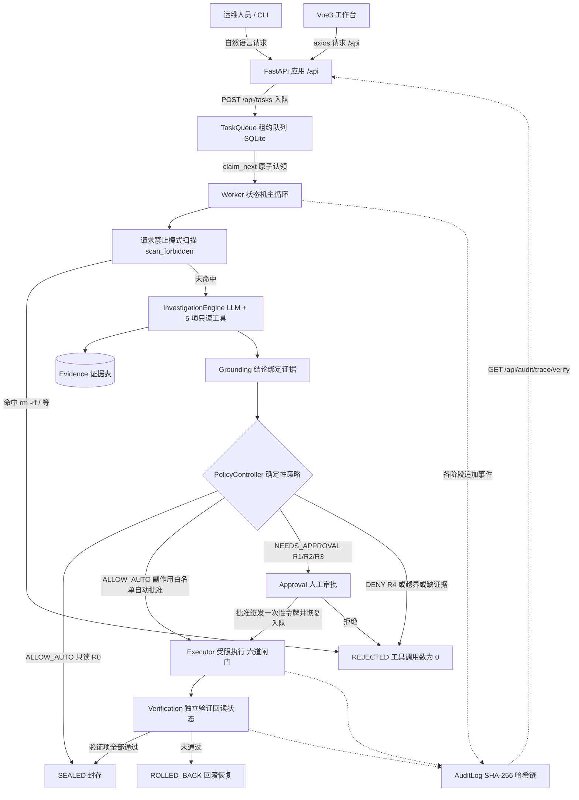
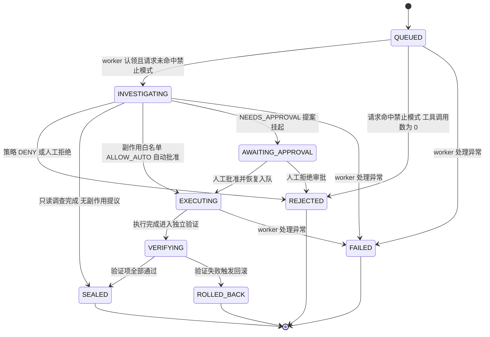

# Grad-Ops 系统架构（毕业设计论文素材）

## 系统概述

Grad-Ops 是一个**证据约束型自主运维控制平面**的毕业项目版：运维人员以自然语言提交请求，系统经请求禁止模式扫描、只读工具取证、LLM 有界调查、结论与证据绑定（Grounding）、确定性策略校验、人工审批、受限执行、独立恢复验证直至 SHA-256 哈希审计链封存，形成完整闭环。核心安全主张是「模型只负责理解与提议，无权自授」——动作能否执行由 `app/policy/` 下与任何 LLM 代码零耦合的确定性规则表决定，执行器按契约摘要、一次性审批令牌、运行身份、路径边界、工具白名单、禁止模式六道闸门顺序放行，验证器必须以全新的只读回读重新确认状态（复用调查证据即视为验证无效）。技术栈为 Python 3.10+ / FastAPI / SQLAlchemy 2.0 + SQLite / httpx / Vue 3 + Vite + Arco Design，单文件数据库零外部依赖，开发机为 Windows，目标运行环境为 Linux。

## 总体架构

说明：

- 用户与前端只经 `FastAPI /api` 交互，任务由 `TaskQueue` 落库，独立 Worker 进程（`scripts/worker.py`）以租约方式认领并按状态机推进。
- LLM 仅出现在调查环节（`app/llm/`），且只能被授予 5 项只读工具；策略、审批、执行、验证四个环节完全不依赖模型输出。
- 审计链是旁路而非事后补记：每个阶段都通过 `AuditLog.append` 写入带 `prev_hash` 的事件。

## 模块表

| 文件路径 | 职责 | 关键类 / 函数 |
| --- | --- | --- |
| `app/main.py` | FastAPI 应用工厂，挂载任务、审批、审计路由与健康检查 | `build_app()` |
| `app/config.py` | pydantic-settings 配置（`.env` + `GRADOPS_` 前缀），LLM、执行器、调查上限参数 | `Settings`、`settings` |
| `app/db.py` | SQLAlchemy 2.0 引擎、会话工厂、依赖注入与建表 | `Base`、`engine`、`SessionLocal`、`get_session`、`init_db` |
| `app/enums.py` | 任务状态、风险等级、提案状态、作业状态四组枚举 | `TaskStatus`、`RiskLevel`、`ProposalStatus`、`JobStatus` |
| `app/models.py` | 8 张表的 ORM 模型与 UTC 时间戳、trace_id 生成 | `Task`、`TaskJob`、`Evidence`、`ActionProposal`、`Approval`、`ExecutionRecord`、`VerificationRecord`、`AuditEvent`、`utcnow` |
| `app/audit.py` | SHA-256 哈希链追加与逐条重算校验 | `AuditLog.append`、`AuditLog.verify_chain`、`stable_hash` |
| `app/contract.py` | 动作契约构建、摘要绑定与防篡改比对 | `build_contract`、`assert_contract_matches`、`copy_contract`、`ContractTampered` |
| `app/queue.py` | SQLite 租约队列：入队、原子认领、心跳、失败与重试 | `TaskQueue.enqueue`、`claim_next`、`heartbeat`、`mark_failed`、`JobStateError` |
| `app/worker.py` | 任务状态机主循环：扫描 → 调查 → 策略 → 审批/执行 → 验证 | `Worker.run_once`、`_investigate`、`_handle_proposal`、`_resume`、`_execute_and_verify` |
| `app/investigation.py` | 有界迭代 LLM 调查循环，只读工具取证，拒绝非只读请求 | `InvestigationEngine.run`、`InvestigationResult` |
| `app/grounding.py` | 结论与证据绑定校验，丢弃引用不存在证据的结论 | `bind_claims_to_evidence`、`apply_grounding`、`GroundingResult` |
| `app/executor.py` | 受限执行器与执行前六道闸门，审批令牌签发与一次性消费 | `execute_approved`、`issue_approval_token`、`verify_approval_token`、`ExecutionDenied` |
| `app/verification.py` | 独立恢复验证（禁复用调查证据）与失败回滚 | `verify_recovery`、`rollback_backup`、`VerificationIndependenceError` |
| `app/platform.py` | Windows / Linux 命令执行适配：超时、编码、返回结构统一 | `run_command`、`run_powershell`、`CommandResult` |
| `app/policy/boundary.py` | 路径正斜杠小写规范化与「保护表 + 允许表」双闸门判定 | `authorize_path`、`BoundaryViolation`、`ALLOWED_PREFIXES`、`PROTECTED_PREFIXES` |
| `app/policy/rules.py` | 风险决策表、副作用工具白名单、危险模式正则 | `RISK_DECISION`、`SIDE_EFFECT_WHITELIST`、`scan_forbidden` |
| `app/policy/controller.py` | 确定性策略控制器，按固定顺序裁决且不 import 任何模型代码 | `PolicyController.evaluate`、`PolicyDecision` |
| `app/llm/client.py` | OpenAI 兼容客户端，mock / live 双模式、重试与 JSON 解析 | `LLMClient.complete_json`、`LLMUnavailable`、`LLMFormatError` |
| `app/tools/base.py` | 工具规格数据类与工具异常 | `ToolSpec`、`ToolError` |
| `app/tools/observation.py` | 5 项只读观测工具及 Linux/Windows 双平台解析 | `list_listening_ports`、`list_processes`、`disk_usage`、`read_service_log`、`check_service_health` |
| `app/tools/side_effect.py` | 2 项副作用工具处理器 | `backup_log_file`、`rotate_log_file`、`register_side_effect_tools` |
| `app/tools/registry.py` | 工具注册表，按只读 / 副作用分组查询 | `ToolRegistry`、`build_registry` |
| `app/api/tasks.py` | 任务提交、列表、详情与审计时间线路由 | `create_task`、`list_tasks`、`get_task`、`get_task_timeline` |
| `app/api/approvals.py` | 审批队列、批准 / 拒绝、手动驱动一次队列 | `approve`、`reject`、`list_approvals`、`run_queue` |
| `app/api/audit.py` | 哈希链校验与运行时安全报告 | `verify_trace`、`safety_report` |
| `app/api/__init__.py` | 路由子包声明 | — |

辅助入口：`scripts/worker.py`（独立 Worker 进程）、`scripts/run_dev.ps1` / `scripts/run_dev.sh`（开发启动 uvicorn）。

## 数据模型（8 张表）

| 表 | 关键字段 | 说明 |
| --- | --- | --- |
| `tasks` | `id`、`trace_id`（唯一索引）、`request_text`、`source`、`status`、`summary`、`created_at`、`updated_at` | 任务主体；`trace_id` 是审计链与时间线的串联键 |
| `task_jobs` | `task_id`、`status`、`lease_owner`、`lease_expires_at`、`attempt_count`、`last_error`、`available_at` | 队列作业；租约字段支撑互斥认领与过期重领 |
| `evidences` | `task_id`、`tool_call_id`、`kind`、`summary`、`payload_json`、`content_hash` | 只读工具取证结果；`content_hash` 对结果做稳定哈希 |
| `action_proposals` | `task_id`、`tool_name`、`input_json`、`risk_level`、`rationale`、`preconditions_json`、`postconditions_json`、`rollback_json`、`policy_ref`、`contract_digest`、`status` | LLM 处置提议，也是动作契约的载体 |
| `approvals` | `proposal_id`、`token_hash`、`status`（PENDING / APPROVED / REJECTED / CONSUMED）、`decided_by`、`decided_at`、`comment` | 人工审批记录；只存令牌哈希，消费后置 `CONSUMED` |
| `execution_records` | `proposal_id`、`ok`、`exit_code`、`stdout`、`stderr`、`duration_ms`、`executed_at` | 受限执行结果 |
| `verification_records` | `task_id`、`proposal_id`、`checks_json`、`passed`、`note`、`verified_at` | 独立验证结论，`checks_json` 记录逐项检查明细 |
| `audit_events` | `trace_id`、`seq`、`stage`、`event_type`、`message`、`payload_json`、`prev_hash`、`payload_hash`、`event_hash`；`(trace_id, seq)` 唯一索引 | 哈希链事件：`event_hash = H(prev_hash, payload_hash)` |

## 任务状态机

两条拒绝入口：一是请求级扫描（`scan_forbidden`）在**零工具调用**下直接 `QUEUED → REJECTED`；二是策略级 `DENY`（R4、工具不在白名单、路径越界、缺少前置证据）或人工拒绝审批，使任务进入 `REJECTED`。

## 与原 OpsCouncil 的差异

| 维度 | 原 OpsCouncil | Grad-Ops 毕业项目版 |
| --- | --- | --- |
| 存储 | PostgreSQL + pgvector 知识库 | SQLite（SQLAlchemy 2.0），单文件、零外部依赖 |
| 智能体编排 | 5 角色多 Agent 协作 | 单一调查 Agent（`InvestigationEngine`）+ 独立确定性策略控制器 |
| 通道与运营能力 | 飞书通道、巡检调度、评测靶场 | 无，仅 REST API 与 Vue3 工作台 |
| 工具规模 | 27 项工具 | 7 项（5 项只读观测 + 2 项副作用） |
| 代码与测试规模 | 约 300 个 Python 文件、134 个测试 | `app/` 下 30 个模块、138 个测试用例 |
| 部署形态 | Docker 编排、systemd 生产加固 | 单进程 FastAPI + 独立 worker 脚本，venv 直接运行 |

「明确不做」清单（见 `docs/specs/2026-10-14-core-loop-spec.md`）：pgvector 知识库、5 角色多 Agent 编排、飞书通道、巡检调度、评测靶场、Docker 编排、systemd 生产加固。
