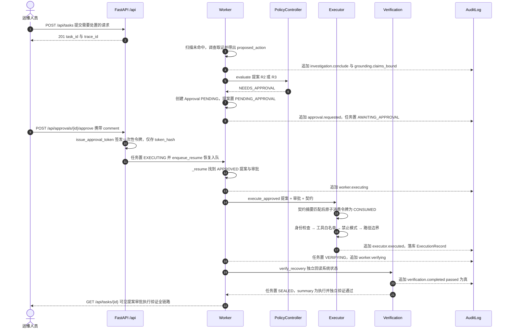

# 时序图：受控处置路径（审批 → 执行 → 独立验证 → 封存）

- `NEEDS_APPROVAL` 的挂起发生在策略层：`Worker._park` 创建 `PENDING` 审批记录并把任务停在 `AWAITING_APPROVAL`，此时**没有任何执行发生**。
- 批准接口签发的原始令牌不落库，`approvals.token_hash` 只保存 SHA-256；执行前由 `executor._gate_approval` 校验并把状态原子置为 `CONSUMED`，令牌一次性使用。
- 执行前六道闸门顺序固定：契约匹配 → 审批令牌状态 → 运行身份 → 副作用工具白名单 → 禁止模式 → 路径边界，任一失败即抛 `ExecutionDenied` 并写 `executor.denied`。
- 验证阶段只允许只读回读：`verify_recovery` 按 `postconditions_json` 逐项检查（`path_exists` / `path_missing` / `execution_ok`），并且拒绝传入调查阶段的 `evidence_id`（抛 `VerificationIndependenceError`）。
- 验证通过后任务才进入 `SEALED`；整个链路可在 `/api/tasks/{id}/timeline` 按审计 `seq` 逐条回放。
