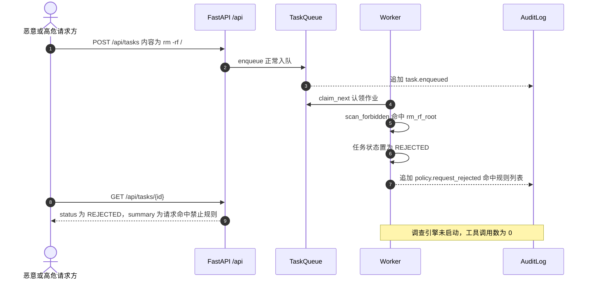
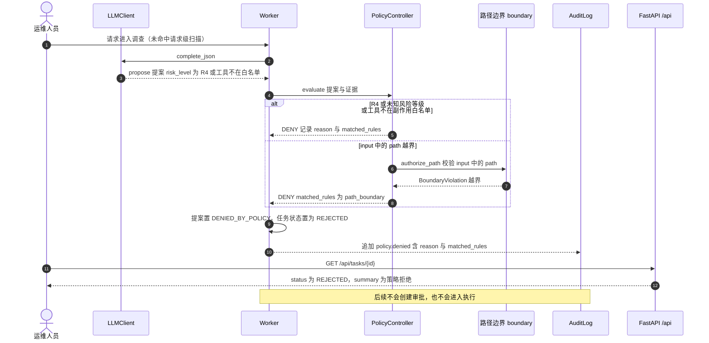

# 时序图：恶意请求与策略拒绝路径（REJECTED，零工具调用）

## 场景一：请求级禁止模式扫描（零工具调用直接拒绝）

## 场景二：策略级 DENY（R4 / 工具越界 / 路径越界）

- 请求级扫描发生在调查**之前**：`Worker._investigate` 第一步执行 `scan_forbidden(task.request_text)`，命中即 `REJECTED`，`InvestigationEngine` 根本不启动，工具调用数为 0。
- 策略级拒绝发生在提议之后、执行之前：`PolicyController.evaluate` 按「风险等级 → 工具白名单 → 路径边界 → 禁止模式 → 前置证据 → 审批令牌」固定顺序裁决，任一 `DENY` 立即返回并携带 `matched_rules`。
- R4（危险 / 越权）、未知风险等级、非白名单副作用工具、路径属于受保护目录、前置条件引用不存在的证据，五类输入都会得到 `DENY`。
- 人工审批拒绝是第三条 `REJECTED` 入口：`POST /api/approvals/{id}/reject` 把审批置 `REJECTED`、提案置 `REJECTED`、任务置 `REJECTED`，同样不会触发执行。
- 所有拒绝均落审计（`policy.request_rejected` / `policy.denied` / 审批拒绝事件），可在时间线与 `/api/audit/{trace_id}/verify` 中核验。
