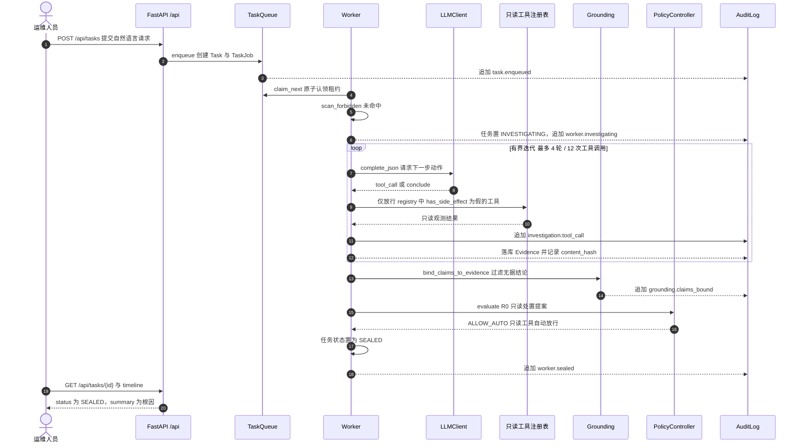

# 时序图：只读调查路径（R0 封存）

- 入队即写审计：`TaskQueue.enqueue` 同时创建 `Task`、`TaskJob` 并追加 `task.enqueued` 事件，之后每个状态迁移都伴随审计事件。
- 调查是**有界迭代**：轮次上限 `GRADOPS_INVESTIGATION_MAX_ITERATIONS`（默认 4）、工具调用上限 `GRADOPS_INVESTIGATION_MAX_TOOL_CALLS`（默认 12），另有 120 秒超时；触顶即强制收敛并标记 `truncated`。
- 工具侧只读防线独立于提示词：即使模型请求副作用工具，`InvestigationEngine._handle_tool_call` 也会拒绝并中止调查（`investigation.invalid_tool_call`），不产生任何副作用。
- `Grounding` 把每条结论与真实 `evidence_id` 比对，引用不存在证据或零引用的结论被丢弃并写入 `grounding.claims_bound`。
- 只读路径不产生副作用提议（`proposed_action` 为空或策略判 `ALLOW_AUTO` 且非副作用白名单工具）时，任务直接 `INVESTIGATING → SEALED`，全程零人工介入、零副作用调用。
