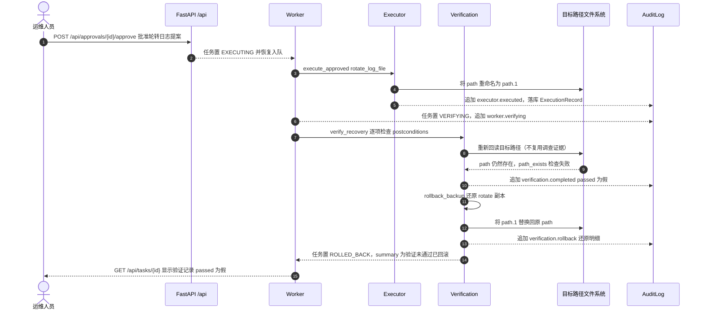

# 时序图：验证失败回滚（ROLLED_BACK）

- 触发条件是**验证项失败而非执行失败**：`verify_recovery` 读取提案的 `postconditions_json`，任一检查（如 `path_exists`）不通过即 `passed=False`，任务从 `VERIFYING` 转 `ROLLED_BACK`。
- 回滚动作由 `rollback_backup` 按工具类型决定：`rotate_log_file` 把 `<path>.1` 通过 `os.replace` 还原为原文件；`backup_log_file` 属于增量备份，标注「无需回滚」；其他工具记录「无需回滚」。
- 回滚本身也会写审计（`verification.rollback`），确保「失败 → 恢复」同样可追溯；`ExecutionRecord` 仍保留，便于对照执行与验证两个阶段的结论。
- 验证阶段的所有检查都是**新的回读**：不携带调查阶段的 `evidence_id`，否则直接抛 `VerificationIndependenceError`，因此失败结论无法被调查证据「洗白」。
- 终态 `ROLLED_BACK` 属于终态集合（与 `SEALED`、`REJECTED`、`FAILED` 并列），队列不会再为其生成作业；若验证通过则任务转 `SEALED`，对照组见 `docs/sequence-approval.md`。
