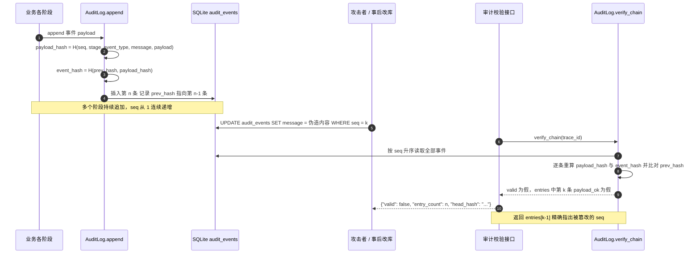

# 时序图：审计篡改检测（哈希链校验）

- 追加（`AuditLog.append`）先取同 `trace_id` 的最后一条事件，以其 `event_hash` 作为本条 `prev_hash`，`seq` 严格递增；首条事件的 `prev_hash` 为 64 个 0。
- 稳定哈希使用 `json.dumps(sort_keys=True, separators=(",", ":"))` + SHA-256，同样的内容永远得到同样的摘要，避免键序与空白导致的误报。
- 篡改模型覆盖三种：直接改 `payload_json`（`payload_ok` 变假）、改字段后重算 `payload_hash` 但不动 `event_hash`（`event_ok` 变假）、删除中间事件（`prev_ok` 链断裂）。
- `verify_chain` 从创世哈希开始整链重算，`valid` 只有在**每一条**的 `prev_ok`、`payload_ok`、`event_ok` 全部为真时才为真，并逐条给出 `stored_event_hash` 与 `expected_event_hash` 便于论文取证。
- 对外暴露为 `GET /api/audit/{trace_id}/verify`（可加 `?full=true` 查看逐条结果），前端「审计校验」页直接调用；`GET /api/tasks/{id}/timeline` 按 `seq` 展示，篡改后消息与哈希结论同时可见。
